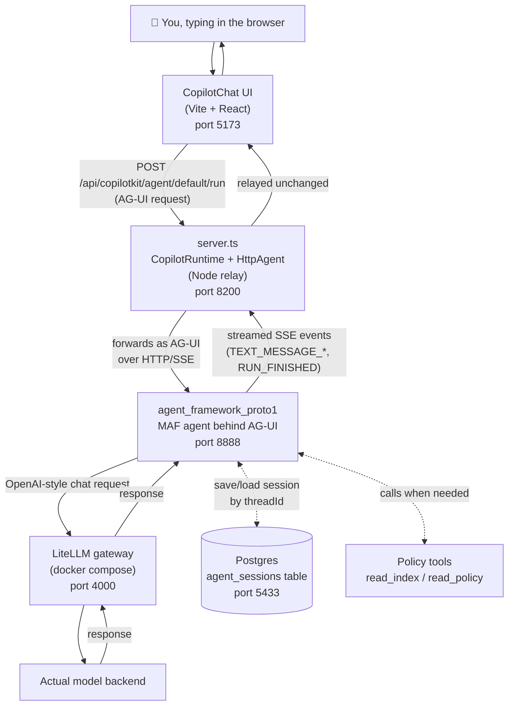

# Prototype 1: Microsoft Agent Framework + AG-UI + CopilotKit

A React chat window talking to a .NET agent, with Postgres remembering
conversations across restarts.

## The idea in one sentence

Four programs sit in a row, each one just forwarding the chat to the next,
until it reaches the AI model — and a database on the side remembers each
conversation so it survives a restart.

## The four programs

1. **The browser** — the chat window you actually type into
   (`CopilotChat`, rendered by Vite/React).
2. **`copilotkit_quickstart/server.ts`** — a small Node.js relay. Its only
   job is "take what the browser sends, pass it to the .NET agent, pass the
   answer back."
3. **`agent_framework_proto1`** — the .NET program that actually *is* the
   agent. It owns the system prompt, the tools (`read_index`/`read_policy`
   for Kutztown policies), and now, a Postgres-backed memory of each
   conversation.
4. **LiteLLM → the model** — the agent doesn't call OpenAI/Anthropic/etc.
   directly; it calls a local gateway (LiteLLM) that forwards to whichever
   model is configured.

Alongside all of that, a **Postgres container** stores conversation state
for #3, keyed by a `threadId`, so if you restart the .NET server and come
back with the same thread id, the agent remembers what you talked about.

## Diagram



## What each hop is actually doing

| Step | What happens |
|---|---|
| 1 | You type a message in `CopilotChat`. |
| 2 | The browser sends it to the Node relay (`server.ts`) as an AG-UI request — this includes a `threadId` so the same conversation can be found again later. |
| 3 | The relay doesn't think about it at all — it just hands the request to the .NET agent server over AG-UI. |
| 4 | The .NET agent loads any saved history for that `threadId` from Postgres, adds your new message, and calls the model (via LiteLLM) — using the policy tools if the question calls for them. |
| 5 | The agent saves the updated conversation back to Postgres, then streams the answer back as a series of small SSE events. |
| 6 | The relay passes those events straight through to the browser, which renders them as they arrive. |

## Why it's split into four pieces instead of one

- **The browser UI and the relay are CopilotKit's half** — it knows how to render a chat window and speak AG-UI, but nothing about agents or AI.
- **The .NET program is Microsoft Agent Framework's half** — it owns the agent logic, tools, and memory, but has no UI of its own.
- **AG-UI is the shared language** between those two halves — a standard set of HTTP/SSE events (`RUN_STARTED`, `TEXT_MESSAGE_CONTENT`, `TOOL_CALL_*`, `RUN_FINISHED`) so CopilotKit's UI can talk to *any* AG-UI-compatible agent backend, not just this one.
- **LiteLLM decouples the agent from any one AI provider** — swapping models is a config change, not a code change.

## Ports

| Component | Port | Project |
|---|---|---|
| LiteLLM gateway | 4000 | docker compose (`litellm`) |
| AG-UI agent server | 8888 | `agent_framework_proto1` |
| CopilotKit runtime (Node) | 8200 | `copilotkit_quickstart/server.ts` |
| Vite dev server (React UI) | 5173 | `copilotkit_quickstart/src` |
| Postgres (agent memory) | 5433 | docker compose (`agent_memory_db`) |

## Key packages

- **`agent_framework_proto1`**: `Microsoft.Agents.AI.OpenAI`,
  `Microsoft.Agents.AI.Hosting.AGUI.AspNetCore` (prerelease), `Npgsql`,
  `HtmlAgilityPack`.
- **`copilotkit_quickstart`**: `@copilotkit/runtime` (v2 API),
  `@ag-ui/client` (`HttpAgent`), `@copilotkit/react-core` (v2 API:
  `CopilotKitProvider`, `CopilotChat`), Vite, React 18.

## How to run

Everything this prototype needs lives in this folder.

1. **Start LiteLLM + the two Postgres databases:**

   ```sh
   cd examples/prototype1
   docker compose up
   ```

   - If you're using the `anthropic/*` route (the simplest option), export
     `ANTHROPIC_API_KEY` before running `docker compose up`.
   - If you're using the default `chatgpt/gpt-6.1-sol` route, you need a
     ChatGPT subscription OAuth token at `~/.config/litellm/chatgpt`
     (create the directory first if it doesn't exist) — otherwise remove
     that volume mount and the chatgpt model entry from
     `litellm_config.yaml`.

2. **Run the .NET agent** (in a new terminal):

   ```sh
   cd examples/prototype1/agent_framework_proto1
   LITELLM_BASE_URL=http://localhost:4000 \
   LITELLM_API_KEY=admin \
   LITELLM_MODEL=anthropic/claude-sonnet-5 \
   dotnet run
   ```

   (`LITELLM_MODEL` defaults to `chatgpt/gpt-6.1-sol` if unset; override it
   to use the `anthropic/*` route instead. `AGENT_MEMORY_DB_CONNECTION_STRING`
   also has a default matching the compose file above, so it only needs to
   be set if you changed those credentials.)

3. **Run the CopilotKit relay + UI** (two more terminals):

   ```sh
   cd examples/prototype1/copilotkit_quickstart
   npm install   # first time only
   npm run runtime   # Node relay on port 8200
   npm run dev       # Vite dev server on port 5173
   ```

4. Open `http://localhost:5173` and chat.

## Known gaps / things not yet verified

- Not yet confirmed in an actual browser that `CopilotChat` picks up the
  `default` agent without an explicit `agentId` prop — only verified via
  direct `curl` against the runtime and AG-UI server, not through the
  React client.
- No auth, no CORS lockdown (runtime has `cors: true` wide open) — fine
  for a bare-minimum prototype, not production-ready as-is.
- `Microsoft.Agents.AI.Hosting.AGUI.AspNetCore` and `AgentSessionStore` are
  prerelease/experimental APIs; expect breaking changes on upgrade.
- Session persistence covers the AG-UI/MAF conversation thread only — it's
  separate from `agent_framework_quickstart`'s `ChatHistoryProvider`
  approach (different project, different table, different mechanism) and
  not wired together with it.
